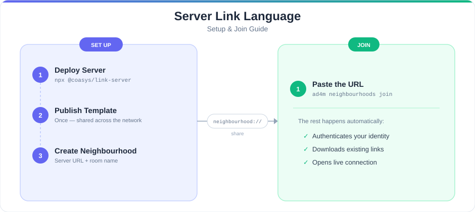

# Server Link Language

An [AD4M](https://ad4m.dev) link language that syncs a perspective through a
self-hosted [**link-server**](../../link-server/README.md)
instance — HTTP for auth, commit, and catch-up sync; a native WebSocket for
real-time diff push, presence, and telepresence. Every AD4M link-language capability is implemented:
`perspective-commit`, `perspective-sync`, `perspective-query`, `peers`, and
`telepresence`. Every room's links are end-to-end encrypted from creation:
they leave the agent only as ciphertext, and there is no plaintext mode.
Presence and telepresence signals are not encrypted (`src/telepresence.ts`):
the link server relays them as sent.

Built on the modern [ALDK](https://github.com/coasys/ad4m/tree/dev/ad4m-ldk)
(`@coasys/ad4m-ldk`) pattern — see
[`ad4m-link-language-template`](https://github.com/coasys/ad4m-link-language-template)
for the skeleton this project extends.



## Prerequisites

- **[Deno](https://deno.land/)** (v1.32+) — the executor runtime and the build script
- **[Node.js](https://nodejs.org/)** (v20+) + npm/pnpm — dev dependencies and tests
- **`@coasys/ad4m-ldk`** cloned at a sibling path (`../ad4m/ad4m-ldk/js/`), or set `AD4M_LDK_ENTRY` to the compiled `lib/index.js`

## Quick start

```bash
NODE_ENV=development pnpm install     # or npm install
deno run --allow-all esbuild.ts       # -> build/bundle.js
node --experimental-vm-modules --import tsx --test tests/*.test.ts
npx tsc --noEmit
```

## Usage

### For neighbourhood creators

#### 1. Run a server

Deploy a [**link-server**](../../link-server/README.md) instance on your own hardware. One command gets you started:

```bash
npx @coasys/link-server --port 3457 --data ./my-data
```

See the [link-server README](../../link-server/README.md) for Docker setup, access control, and encryption options.

#### 2. Publish the language template (one time)

Register the language code on the AD4M network. This only needs to happen once — after that, everyone reuses the same template address.

```bash
ad4m languages publish ./build/bundle.js \
  --name server-link-language \
  --description "Link language syncing through a self-hosted link-server" \
  --possible-template-params SERVER_URL,UID,CREATOR
```

This returns a **template address** (content hash). Save it — you need it in the next step.

If someone else already published the template, skip this step and use their template address.

#### 3. Create an instance pointing at your server

Fill in the template with your server's URL, a unique identifier and your person DID (the room's creator):

```bash
ad4m languages apply-template-and-publish <template-address> \
  '{"SERVER_URL": "https://your-server.example.com:3457", "UID": "'$(uuidgen)'", "CREATOR": "did:scid:coasys:1:..."}'
```

The room id is `roomIdOf(CREATOR, UID)` (`src/room.ts`): `base58(sha256(CREATOR ‖ 0x00 ‖ UID))`. A `UID` is unique per creator, and the language hash depends only on the three parameters, so no other template parameter can cause address collisions.

This returns an **instantiated language address** — the template code with your server details baked in.

#### 4. Create a neighbourhood

```bash
ad4m perspectives create                              # → perspective UUID
ad4m neighbourhoods create <perspective-UUID> <instantiated-language-address>
```

This returns a **neighbourhood URL** (`neighbourhood://Qm...`). Share it with anyone you want to invite.

The room exists once its creator writes the space's first membership links (the `rules` link, with the genesis `{creator, salt: UID}`) to the server's `/membership`; until then every agent's `init()` logs "the room does not exist yet" and waits. Who belongs to the room is decided by those signed membership links, not by the server: see [Rooms and membership](../../link-server/README.md#rooms-and-membership-protocol-2).

### For users joining a neighbourhood

One command:

```bash
ad4m neighbourhoods join neighbourhood://Qm...
```

Everything else happens automatically:

- The language code downloads (with the server URL and room ID already filled in)
- Your agent authenticates with the server using your DID
- All existing links pull down to your local store
- A live connection opens for real-time updates

No server address to type, no account to create, no configuration needed. The neighbourhood URL contains everything.

Once joined, the neighbourhood works like any other. Links you create sync to the server and push to every connected agent in real time. Links from other agents appear as they arrive. If your connection drops, the language reconnects and catches up on anything it missed.

## The server this language talks to

[`link-server`](../../link-server/README.md) — a
self-hosted HTTP+WebSocket server. One "room" = one AD4M neighbourhood.

### HTTP

Protocol 2; the full list is in the [link-server API](../../link-server/README.md#api). What this language uses:

| Method & path | Purpose |
|---|---|
| `POST /rooms/:roomId/auth` | `{did, signature, timestamp, x25519PublicKey, x25519Signature}` → `{token, expiresAt, admitted}`; 404 while the room does not exist |
| `POST /rooms/:roomId/membership` | Membership links (`coasys://membership/...`), plain and signed: `{genesis?, links}` → `{results}`. The creator's first call (with `genesis`) makes the room |
| `GET /rooms/:roomId/membership?since=<seq>` | The membership log after `seq` → `{links, seq}`; each link goes to the executor (`membershipLinks`) |
| `GET /rooms/:roomId/members` | The admitted keys, each with its X25519 key and signed statement |
| `POST /rooms/:roomId/commit` | Push a `{additions, removals}` diff of encrypted links (base64 `{ciphertext, nonce}`); the server refuses a plaintext link and a membership predicate (400) |
| `GET /rooms/:roomId/sync?since=<sequence>&limit=100` | Pull up to 100 diffs newer than `sequence` → `{diffs[] (each with its sequence), revision, sequence, next}` |
| `GET /rooms/:roomId/render?limit=500[&next=<cursor>]` | One page of the snapshot pinned at `upto` → `{links[], revision, sequence, upto, next}` |
| `GET /rooms/:roomId/peers` | Connected agent DIDs → `{peers: string[]}` |
| `GET /rooms/:roomId/keys` | This key's sealed room key versions → `{keys: [{encryptedKey, version, commitment}]}`. Empty: this key waits for one; 403: the room does not admit this key |
| `POST /rooms/:roomId/keys/rotate` | Any member: `{keys, commitment}`, a new version sealed to exactly the admitted keys (409 otherwise) |
| `DELETE /rooms/:roomId/keys/:version` | Any member: drops its own box for a version whose key does not match the commitment, so a holder grants it again |
| `GET /rooms/:roomId/keys/missing` | Any member: `{membersNeedingHistoricalKeys: [{did, missingVersions}]}` |
| `POST /rooms/:roomId/keys/grant` | Any member: `{targetDid, keys: [{version, encryptedKey}]}`, only versions the caller holds |

### WebSocket — `/rooms/:roomId/ws`

Server → client: `diff`, `telepresence-signal`, `telepresence-broadcast`,
`online-agents`, `peer-joined`, `peer-left`, `status-changed`,
`keys-granted {versions}` (to the grantee's sockets after a stored grant: the
language refreshes its key ring and catches up), `membership` (a counted
membership link: to the executor), `rotate-needed {reasons, removedKeys}`
(members holding a key rotate), `auth-error`. Close codes: `4005` (this key
was removed or revoked: the key ring is dropped and the socket stays closed
until the next `init()`), `4006` (room suspended).
Client → server: `telepresence-signal`, `telepresence-broadcast`,
`set-online-status`.

This language uses the **native `WebSocket` global** — no socket.io. The
executor's language sandbox runs a full `deno_runtime` worker (not a bare
`deno_core` isolate), so `WebSocket`/`fetch`/`crypto` are present; see
`src/adapters-deno.ts` `DenoWebSocketFactory`.

## Architecture

### Pure / impure separation

- **Pure** (`src/types.ts`, `src/store.ts`, `src/adapters.ts`, `src/api.ts`,
  `src/auth.ts`, `src/sync.ts`, `src/ws-client.ts`, `src/telepresence.ts`,
  `src/encryption.ts`, `src/room.ts`, `src/room-keys.ts`) — no `ad4m:host` imports. Everything talks to the
  outside world through the `Transport` / `StorageAdapter` / `AgentAdapter`
  / `RuntimeAdapter` / `WebSocketFactory` interfaces in `src/adapters.ts`,
  swapped for mocks in tests.
- **Impure** (`src/adapters-deno.ts`) — wraps `ad4m:host` imports and the
  native `WebSocket` global. Only imported from `index.ts` during `init()`.

### Module map

| Module | Responsibility |
|---|---|
| `src/store.ts` | Local link store (indexed by source/target/predicate) + sync cursor (revision, sequence) + held links (inbound, waiting for a key) |
| `src/api.ts` | Typed HTTP client for every server endpoint |
| `src/auth.ts` | DID challenge-response flow + token expiry tracking/refresh |
| `src/ws-client.ts` | WebSocket lifecycle: connect, typed message dispatch, send queue, exponential-backoff reconnect |
| `src/sync.ts` | Commit (stored locally once the server accepted it, not echoed back) / catch-up sync / cold-start bootstrap; the single inbound path |
| `src/telepresence.ts` | Online-agent roster + outbound signal/broadcast/status |
| `src/room.ts` | Protocol 2: room id, auth message, the signed X25519 statement, membership links on the wire |
| `src/encryption.ts` | Room keys sealed with the keyring binding (`keyring/keyring.js`), key ring, AES-256-GCM link encryption |
| `src/room-keys.ts` | Any member's rotation and grants, sealed only to keys the space admits |
| `index.ts` | Wires it all together behind `defineLanguage()` |

### The `emitPerspectiveDiff` rule

The AD4M executor **discards the return value of `perspectiveSyncSync()`**.
The only way an inbound link becomes queryable is calling
`emitPerspectiveDiff(diff)`. Every inbound link in this language — HTTP
catch-up entries, WebSocket `"diff"` pushes and the startup `/render`
snapshot alike — goes through one path in `src/sync.ts`: `openOrHold`, then
`applyAndEmit`, the only place that calls it. `applyAndEmit` emits what
changed in the language's store (additions it did not hold, removals of
links it held), so each link reaches the executor once, however many paths
deliver it. See the module doc comment there before adding a second
inbound-diff path.

### Links that arrive before their key

A member can receive links encrypted with a room key version it does not
hold yet: it joined before a member holding the key granted it. Such a link
is **held** in the store (`held/<link_hash>`), never dropped, so the sequence
cursor moves on safely. `retryHeld` opens every held link the key ring opens,
and runs whenever the key ring loads (init, a `keys-granted` push, a commit)
and at the end of every catch-up; while links are held, each catch-up
re-reads `/keys` first. A later operation on the same link replaces its held
one, so a link added and then removed before the key arrived is never
emitted. A link the key it names does not open (malformed ciphertext or
payload) is logged and skipped, inbound or held: no key ever opens it, and it
costs that one link, not the rest of its batch or the other held links.

### Sync strategy

- `init()` runs `bootstrap()`. A member with a cursor above 0 catches up:
  it tails `/sync` from its cursor, which brings every change since (the
  link server keeps the whole diff log). A fresh member (cursor 0) loads the
  room's current state as a paged `/render` snapshot pinned at `upto`, then
  tails `/sync?since=upto` (link-server README, "Paged snapshot, then
  tail"), far cheaper than replaying the room's entire diff history. Each
  page (500 links) is applied and emitted as its own diff and the cursor is
  stored after it (`render/progress`), so a restart resumes at the next
  page. Nothing is removed after the last page: a fresh store held nothing
  the server does not have. Once per start, a store at the room's head that
  does not hash to the room's revision (the XOR of the links' `link_hash`)
  loads the same paged render again; until then `render()` answers null.
- The stored `render/progress` is what says a fresh member's render is
  still needed. `init()` stores it before authenticating, so a render that timed out, or
  never ran because authentication failed first, is resumed by catch-up (the
  WebSocket's `onOpen`, the runtime's `sync()`), the way catch-up re-reads
  `/keys` while links are held. A render that never ran starts at the next
  catch-up. After a failed page the next attempt waits 10 s, each further
  failure doubles the wait up to 5 min, and the last page ends the retries
  and resets the wait. Catch-up does not wait for the render, and while one is pending
  it does not tail either: its cursor is 0, so reading the log from it is
  the full replay the render replaces. WebSocket pushes are left to the
  render meanwhile. The render's last page is followed by the tail from
  `upto`.
- The WebSocket pushes live diffs. On every (re)connect, `ws-client.ts`'s
  `onOpen` handler also triggers an HTTP catch-up (`GET /sync?since=<cursor>`,
  100 diffs a page)
  as a belt-and-braces gap-fill for whatever happened while offline.
- `sync.sync()` (called by the runtime on its own timer) always performs the
  same HTTP catch-up. This is deliberately unconditional rather than
  branching on "is the WebSocket connected": because `since` only advances
  after a diff is applied (or its links held), a WebSocket that already delivered
  everything live simply gets back an empty `diffs[]` — there's no separate
  "skip" branch to get wrong.

### End-to-end encryption

See the doc comment at the top of `src/encryption.ts` for the full design;
summary:

- **Room keys are sealed to published X25519 keys.** Each key's X25519 key
  comes from its room-key seed (the `agentRoomKeySeed` host import: an HKDF of
  the agent key, used for nothing else) and is published at auth with a
  statement the key signs. The language seals and opens with the
  `ad4m-keyring` binding (ephemeral X25519 ECDH, HKDF-SHA256, AES-256-GCM, hex
  `{ephemeralPublicKey, nonce, ciphertext}`; vectors in
  `ad4m-keyring/vectors/room-key-seal.json`).
- **Distribution.** Any admitted member seals each new version to every
  admitted key, including keys that never connected, and only to keys whose
  statement verifies and that the executor's membership admits
  (`membershipAdmits`): the server chooses whom `/members` lists, so the
  language does not take its word. The first admitted member without a key
  mints version 1; a `rotate-needed` push (a join, a removal, a revocation)
  makes every member holding a key rotate. Any member holding a version grants
  it to an admitted key lacking it (`src/room-keys.ts`); the server accepts a
  grant only of versions the granter holds.
- **Link confidentiality.** `encryptLinkForWire` / `decryptLinkFromWire`
  protect the whole link (`author`, `timestamp`, `proof`, `data`) with
  AES-256-GCM (fresh nonce per link); the server sees only
  `{data: {ciphertext, nonce}, link_hash, key_version}`, `link_hash` being a
  SHA-256 of the canonical plaintext fields for OR-Set matching. **The
  local store always holds decrypted links; only the wire representation is
  ciphertext.**
- **No plaintext mode.** A link leaves only encrypted: without a room key it
  can open (none granted yet, a network error, a corrupt envelope) the agent
  is `pending` or `error` and `commit()` throws, so the executor keeps the
  diff and retries; `toWireLink` throws without a key ring. Inbound, a
  plaintext link is skipped: no member can commit one, so only a server could
  have put it there.

The `encryptedKey` wire framing (JSON `SealedBox`) is `ad4m-keyring`'s seal;
`link-server` only checks its shape.

## Template variables

```typescript
//!@ad4m-template-variable
const SERVER_URL = "<to-be-filled>";  // e.g. "https://my-server.example.com"

//!@ad4m-template-variable
const UID = "<to-be-filled>";         // unique identifier (UUID), the room's salt

//!@ad4m-template-variable
const CREATOR = "<to-be-filled>";     // the creator's person DID (did:scid:coasys:1:...)
```

Filled in by the executor at publish time. Until all three are, `init()` runs
in an inert mode (logs and returns without attempting any network I/O).

The server-side room id is `roomIdOf(CREATOR, UID)`, used in all API paths
(`/rooms/:roomId/...`). The language hash depends only on these three
parameters — no other parameter can cause address collisions. The
human-readable neighbourhood name lives in the language meta (`name` field),
not in the source code.

Every room is E2E from creation: the link server refuses plaintext links in
every room, before any key exists. The first admitted member without a key
mints key version 1 (in `init()`, or after the membership commit that admits
it). Members receive keys from any member holding them (grants run on
`peer-joined`, at init and after every sync); a member without a key commits
no diff until it has one, re-checks `/keys` on every commit and on every sync
while it holds links it cannot open, and a `keys-granted` push re-checks at
once. There is no plaintext mode.

## Publishing

```json
{
    "languagePath": "./build/bundle.js",
    "languageMeta": {
        "name": "server-link-language",
        "description": "AD4M link language syncing through a self-hosted link-server",
        "possibleTemplateParams": ["SERVER_URL", "UID", "CREATOR"],
        "sourceCodeLink": "https://github.com/coasys/ad4m/tree/dev/bootstrap-languages/server-link-language"
    }
}
```

## License

[Cryptographic Autonomy License v1.0 (CAL-1.0)](LICENSE)
