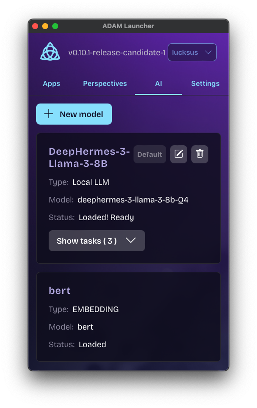
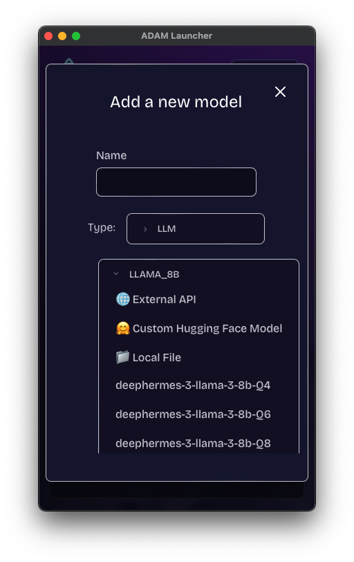
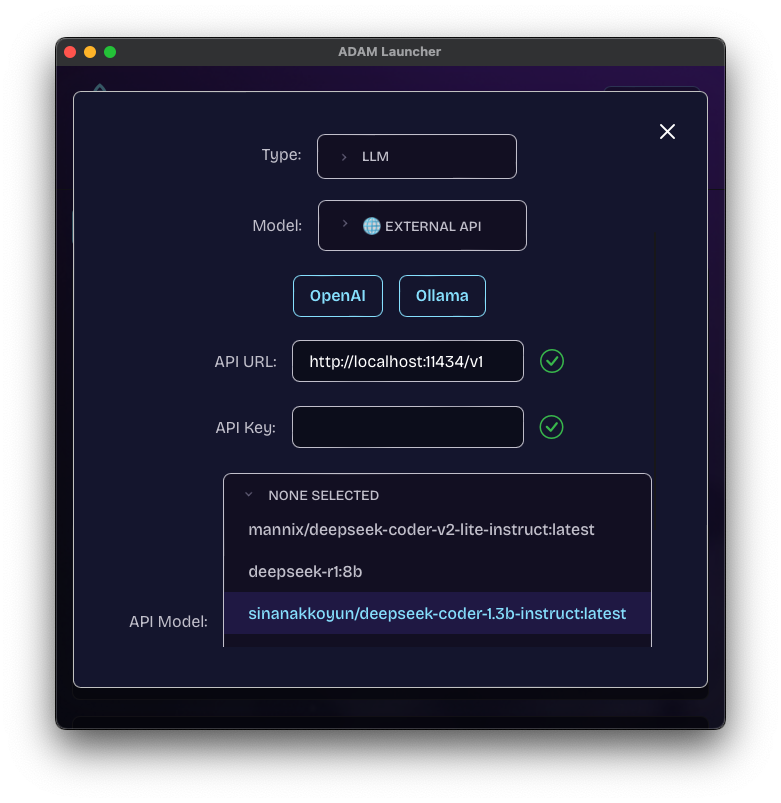

import { Callout } from "nextra/components";

# Configure AI models

The executor has an AI service that runs models locally (GGUF files through llama.cpp, BERT for embeddings, Whisper for speech) or calls a remote API. Apps use them through `client.ai`; the executor's interpretation engine uses the default LLM to turn conversations into typed records ([Agents](../concepts/agents.mdx)).

<Callout type="info">
This page is about running models inside the executor. For AI agents that use AD4M from outside over MCP, see [Connect an agent](../start/connect-an-agent.mdx).
</Callout>

## 1. Add a model

In the Launcher, Settings has an AI section where models are added, downloaded and set as defaults.



From the SDK, `client.ai.addModel(model)` takes a `ModelInput` with `name`, `modelType` (`"LLM"`, `"EMBEDDING"` or `"TRANSCRIPTION"`) and either `local` or `api`, and returns the model id.

### A pre-configured local model

The executor knows a few models by name; give the name as `fileName` and it downloads them from Hugging Face:

```typescript
const modelId = await client.ai.addModel({
  name: "DeepHermes 3 (Q4)",
  modelType: "LLM",
  local: { fileName: "deephermes-3-llama-3-8b-Q4" },
});
```

| `fileName` | Type |
|---|---|
| `Qwen2.5.1-Coder-7B-Instruct` | LLM |
| `deephermes-3-llama-3-8b-Q4`, `-Q6`, `-Q8` | LLM (quantizations of one model) |
| `deepseek_r1_distill_qwen_1_5b`, `_7b`, `_14b`, `deepseek_r1_distill_llama_8b` | LLM |
| `llama_tiny`, `llama_7b_chat`, `llama_3_1_8b_chat`, `mistral_7b_instruct`, `solar_10_7b_instruct` and the other kalosm presets listed in `build_local_llama` | LLM |
| `bert` | EMBEDDING |
| `whisper_tiny`, `whisper_small`, … (full list on [Transcription](./transcription.mdx)) | TRANSCRIPTION |

### Any GGUF from Hugging Face, or a local file

```typescript
await client.ai.addModel({
  name: "Mistral 7B Instruct",
  modelType: "LLM",
  local: {
    huggingfaceRepo: "TheBloke/Mistral-7B-Instruct-v0.1-GGUF",
    fileName: "mistral-7b-instruct-v0.1.Q4_K_M.gguf",
    revision: "main",
    tokenizerSource: { repo: "mistralai/Mistral-7B-Instruct-v0.1", revision: "main", fileName: "tokenizer.json" },
  },
});

await client.ai.addModel({
  name: "My local model",
  modelType: "LLM",
  local: { fileName: "/absolute/path/to/model.gguf" },
});
```



Hardware acceleration is picked at build time: CUDA (`cuda` feature), Metal on macOS (`metal` feature), otherwise CPU.

### A remote API

`api.apiType` is one of `"OPEN_AI"`, `"ANTHROPIC"` or `"OLLAMA"`; `baseUrl`, `apiKey` and `model` name the endpoint. `maxNumCtx` caps the context window Ollama allocates (the other two ignore it). A non-empty `apiKey` is sent only over `https` or to a loopback `http` address; anything else fails with `Refusing to send an API key over plain HTTP. Use https, or omit the key.` (`rust-executor/src/ai_service/providers/http.rs`).

```typescript
await client.ai.addModel({
  name: "Claude",
  modelType: "LLM",
  api: { apiType: "ANTHROPIC", baseUrl: "https://api.anthropic.com", apiKey: process.env.ANTHROPIC_API_KEY!, model: "claude-sonnet-4-5" },
});

await client.ai.addModel({
  name: "Local Ollama",
  modelType: "LLM",
  api: { apiType: "OLLAMA", baseUrl: "http://localhost:11434", apiKey: "", model: "llama3.1" },
});
```



`client.ai.discoverModels(baseUrl, apiKey?, apiType?)` asks an endpoint which model names it serves, so a settings UI can offer a list instead of a text field.

## 2. Wait for it to load

```typescript
let status = await client.ai.modelLoadingStatus(modelId);
while (status.progress < 100) {
  await new Promise((r) => setTimeout(r, 1000));
  status = await client.ai.modelLoadingStatus(modelId);
}
```

## 3. Set defaults

```typescript
await client.ai.setDefaultModel("LLM", modelId);
const llm = await client.ai.getDefaultModel("LLM");
```

The interpretation engine and tasks created with model id `"default"` use the default of their type.

## 4. Tasks and prompts

A task binds a model to a system prompt and examples:

```typescript
const task = await client.ai.addTask(
  "summarizer",
  "default",
  "Summarize the text in two sentences.",
  [{ input: "…a long paragraph…", output: "…two sentences…" }],
);
const answer = await client.ai.prompt(task.taskId, "…text to summarize…");
```

`client.ai.tasks()`, `updateTask(taskId, task)` and `removeTask(taskId)` manage them. Embeddings: `client.ai.embed("bert", text)` returns a `number[]`.

## Manage

`client.ai.getModels()`, `updateModel(modelId, model)`, `removeModel(modelId)`. Capabilities on the `artificial intelligence` domain: `READ` to list models, tasks and loading status; `CREATE` to add, change or remove models and tasks and to set defaults; `PROMPT` for `prompt` and `embed`; `TRANSCRIBE` for streams. A hosted user's default set has `READ`, `CREATE`, `PROMPT` and `TRANSCRIBE`, but `addModel`, `updateModel`, `removeModel`, `setDefaultModel` and `discoverModels` (which needs `CREATE`) refuse a hosted user's session: models are node-wide and the operator's (`rust-executor/src/api/ai_ws.rs`).

## Next

- [Transcription](./transcription.mdx): Whisper streams
- [Agents](../concepts/agents.mdx): interpretation runs and auto-processors that use the default LLM
