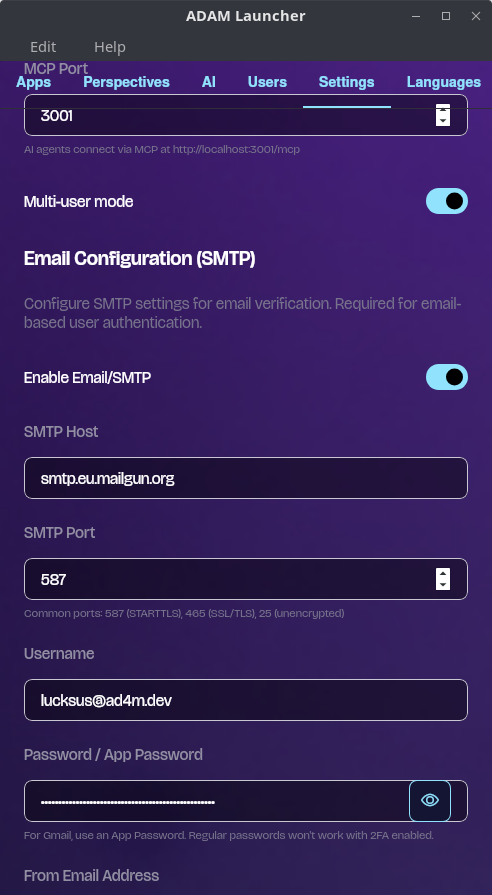
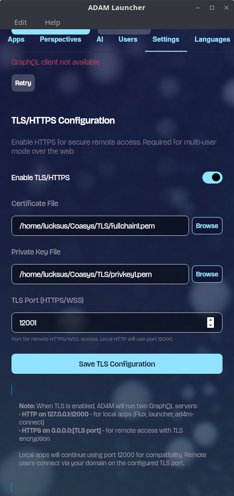

import { Callout } from "nextra/components";

# Host a multi-user executor

You want one executor to serve other people, each with their own DID and perspectives, reachable over the internet. What changes for users and apps, and who holds whose keys, is on [Hosted deployment](../concepts/hosted-deployment.mdx); read it before you offer a host to anyone.

You need: an executor with an admin credential ([Run a headless executor](./headless-executor.mdx), or the Launcher), a domain name pointing at the machine, and a TLS certificate for it.

## 1. Enable multi-user mode

<Callout type="info">
  The screenshots are from an earlier Launcher build, where these fields sat under Settings. In the current Launcher they are in the **Hosting** tab: the "Enable multi-user hosting" toggle at the top, then "TLS Configuration" and "Email Configuration (SMTP)" in its Settings sub-tab.
</Callout>



Headless, any one of:

```bash
ad4m-executor run --config executor-config.json --enable-multi-user true   # or AD4M_ENABLE_MULTI_USER=true
```

```json
{ "multi_user_config": { "enabled": true } }
```

```typescript
// ad4m: an Ad4mClient on http://127.0.0.1:12000 with the admin credential as the token
await ad4m.runtime.setMultiUserEnabled(true);
await ad4m.runtime.multiUserEnabled();   // true
```

The setting is stored in the executor's database. Starting with `enabled: true` turns it on; starting with `false` does not turn it off again (`rust-executor/src/lib.rs`), only `setMultiUserEnabled(false)` does. `setMultiUserEnabled` needs the admin credential; `multiUserEnabled()` is readable without a token (`rust-executor/src/api/users_ws.rs`; `anonymous_capabilities`, `rust-executor/src/agent/capabilities/mod.rs`).

## 2. Serve TLS



```bash
ad4m-executor run --config executor-config.json \
  --tls-cert-file ~/.ad4m/tls/fullchain.pem --tls-key-file ~/.ad4m/tls/privkey.pem   # --tls-port defaults to port + 1
```

or in the config file:

```json
{
  "port": 12000,
  "multi_user_config": {
    "enabled": true,
    "tls_config": {
      "enabled": true,
      "cert_file_path": "/home/ad4m/.ad4m/tls/fullchain.pem",
      "key_file_path": "/home/ad4m/.ad4m/tls/privkey.pem",
      "tls_port": 12001
    }
  }
}
```

With TLS configured the executor binds two RPC listeners (`bind_api_listeners`, `rust-executor/src/api/mod.rs`):

| Listener | Address | For |
|---|---|---|
| HTTP/WS | `127.0.0.1:12000`, whatever `localhost` says | the Launcher, local apps, scripts with the admin credential |
| HTTPS/WSS | `0.0.0.0:12001` | remote users: `https://your-host:12001`, WebSocket at `/api/v1/ws` |

If the certificate or key cannot be read, or the TLS port is taken, the executor logs the error and keeps serving on loopback only; remote access is down until you fix it and restart. The certificate is read at start, so restart after a renewal. With MCP enabled, MCP gets its own HTTPS listener on `mcp_port + 1` with the same certificate (`rust-executor/src/mcp/server.rs`).

Instead of the executor's TLS you can terminate TLS in a reverse proxy in front of `127.0.0.1:12000`: [Behind a reverse proxy](./headless-executor.mdx#behind-a-reverse-proxy).

### A certificate from Let's Encrypt

```bash
sudo apt install certbot
sudo certbot certonly --standalone -d ad4m.example.com                      # port 80 open
sudo certbot certonly --manual --preferred-challenges dns -d ad4m.example.com  # or a DNS TXT record
```

The files land in `/etc/letsencrypt/live/ad4m.example.com/`, readable by root only. Copy them where the executor's user can read them, and repeat that after every renewal with a deploy hook:

```bash
sudo tee /etc/letsencrypt/renewal-hooks/deploy/ad4m-copy-tls.sh > /dev/null <<'EOF'
#!/bin/bash
DOMAIN="ad4m.example.com"
AD4M_USER="ad4m"                       # the user the executor runs as
DEST="/home/${AD4M_USER}/.ad4m/tls"
install -d -o "$AD4M_USER" -g "$AD4M_USER" -m 0700 "$DEST"
install -o "$AD4M_USER" -g "$AD4M_USER" -m 0600 "/etc/letsencrypt/live/${DOMAIN}/fullchain.pem" "$DEST/fullchain.pem"
install -o "$AD4M_USER" -g "$AD4M_USER" -m 0600 "/etc/letsencrypt/live/${DOMAIN}/privkey.pem" "$DEST/privkey.pem"
EOF
sudo chmod +x /etc/letsencrypt/renewal-hooks/deploy/ad4m-copy-tls.sh
sudo /etc/letsencrypt/renewal-hooks/deploy/ad4m-copy-tls.sh   # the first copy
sudo certbot renew --dry-run
```

Restart the executor after a renewal (for the headless unit, `systemctl --user restart ad4m-executor.service` as that user).

## 3. Configure email verification (optional)

Without SMTP, sign-up and login use a password and no email is sent; nothing checks that an address belongs to the person who typed it, so anyone who can reach the host can create an account. With SMTP, a known user can log in with a six-digit code from their inbox, and new accounts get a code at sign-up.

```json
{
  "multi_user_config": {
    "enabled": true,
    "smtp_config": {
      "enabled": true,
      "host": "smtp.example.com",
      "port": 587,
      "username": "ad4m@example.com",
      "from_address": "noreply@example.com",
      "password_file": "/home/ad4m/.config/ad4m/secrets/smtp-password"
    }
  }
}
```

The SMTP password never goes in the file: use `password_file`, `AD4M_SMTP_PASSWORD_FILE` or `AD4M_SMTP_PASSWORD`; an enabled `smtp_config` without one refuses to start (`rust-executor/src/config_file.rs`). There are no command-line flags for SMTP. In the Launcher it is the "Email Configuration (SMTP)" section.

To test the flow without sending mail, the admin can switch on email test mode: `runtime.emailTestModeEnable()`, then `runtime.emailTestGetCode(email)` returns the code that would have been sent (`core/src/runtime/RuntimeClient.ts`).

## 4. DNS, firewall and port forwarding

```bash
dig +short ad4m.example.com          # the machine's public IP (an A record; dynamic DNS for a home line)
sudo ufw allow 12001/tcp             # the TLS port; keep 12000 and 3001 closed
```

Behind a home router, forward TCP 12001 to the machine. Test from **outside** your network (a VPS, a phone on mobile data):

```bash
openssl s_client -connect ad4m.example.com:12001 -servername ad4m.example.com </dev/null   # Verify return code: 0 (ok)
curl -fsS https://ad4m.example.com:12001/health                                            # {"status":"ok"}
```

A test from inside the same LAN against the public name often fails even when outside access works: most consumer routers do not support NAT loopback. Test locally against the LAN address instead.

## 5. Sign up a first user

```typescript
import { Ad4mClient } from "@coasys/ad4m";

const anon = new Ad4mClient("https://ad4m.example.com:12001");
(await anon.runtime.multiUserEnabled());                        // true
const { did, success, error } = await anon.agent.createUser("alice@example.com", "a long password");
const token = await anon.agent.loginUser("alice@example.com", "a long password");
const alice = new Ad4mClient("https://ad4m.example.com:12001", token);
(await alice.agent.me()).did === did;                           // true
```

Apps do this through `@coasys/ad4m-connect` with `hosting: true` (and `remoteUrl: "https://ad4m.example.com:12001"` to pre-fill the host): [Build an app](../start/build-an-app.mdx). Sign-up and login fail with "Executor is locked" until the main agent is unlocked after a restart; set `AD4M_UNLOCK_PASSPHRASE_FILE` so that happens at start.

Each logged-in user gets the default user capability set, not what the app requested: [What a user token may do](../concepts/hosted-deployment.mdx#what-a-user-token-may-do).

## 6. Administer users

With the admin credential:

```typescript
const users = await ad4m.runtime.listUsers();
// [{ email, did, lastSeen?, perspectiveCount, remainingCredits, freeAccess, hotWalletAddress? }, …]

await ad4m.runtime.freeHostingEnabled();                  // true by default
await ad4m.runtime.setFreeHostingEnabled(false);          // writes and AI calls now cost credits
await ad4m.runtime.setUserFreeAccess("alice@example.com", true);
```

`listUsers` needs `runtime.user_management` `READ`, which user tokens do not carry; `setFreeHostingEnabled` needs `runtime` `QUIT` and `setUserFreeAccess` the admin credential (`rust-executor/src/api/runtime_ws.rs`, `users_ws.rs`). In the Launcher, the Hosting tab's Users sub-tab shows the same list. Paid hosting in wHOT and registration with the hosting index (`https://hosting.ad4m.dev` by default, listed in the connect dialog's host browser) are set up in the Launcher's Hosting tab: "Paid hosting via wHOT" and "Host Index Registration". The hosting index needs the host reachable over TLS first.

<Callout type="warning">
  The admin credential is the executor and every user on it. Use it only against the loopback listener (`http://127.0.0.1:12000`); a token travels in the WebSocket URL, and proxies log URLs.
</Callout>

## Reference

- Config keys and flags: [Executor config](../reference/executor-config.mdx) (`multi_user_config`, `--enable-multi-user`, `--tls-cert-file`, `--tls-key-file`, `--tls-port`).
- Capabilities: [Agent, executor and capabilities](../concepts/agent-executor-capabilities.mdx#reference-domains-and-verbs).
