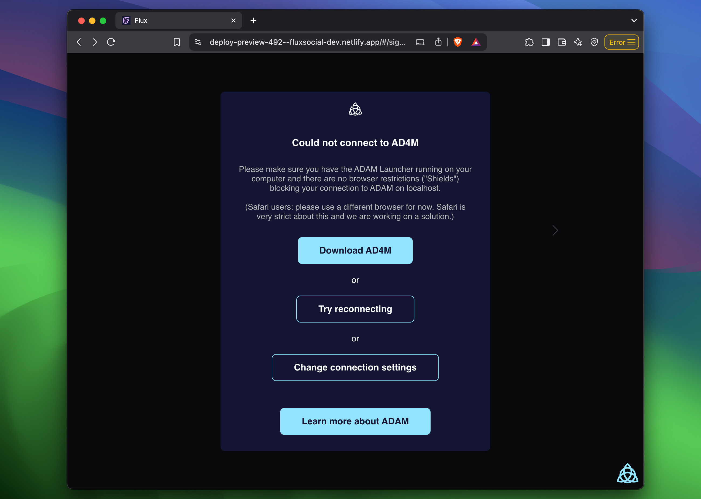
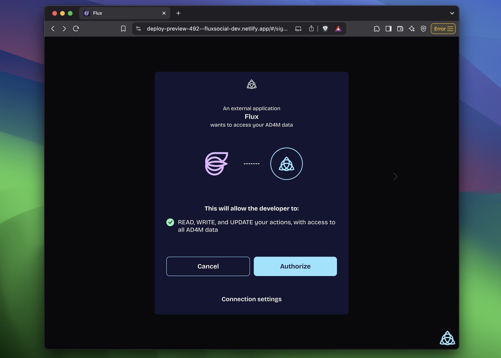
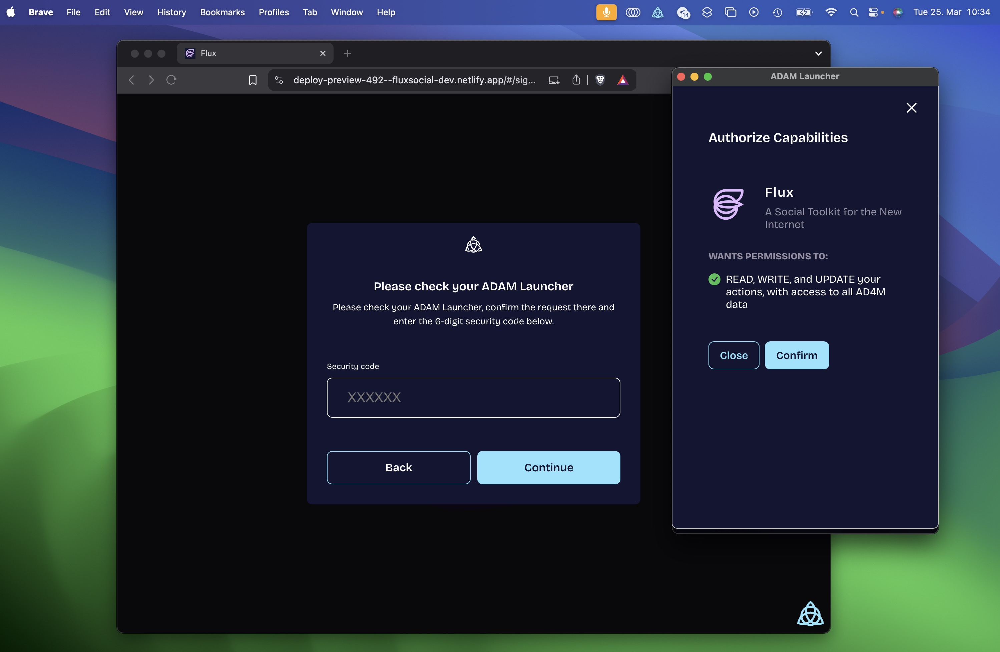
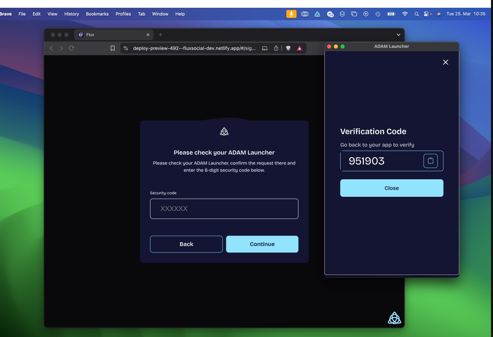

import { Callout } from "nextra/components";

# Build an app

An AD4M app has no server of its own. It connects to the user's executor, asks for the capabilities it needs, and then reads and writes typed records in the user's perspectives. This page gets you from nothing to a first query. The current packages are version `0.13.1-staging.2` (`core/package.json`, `ui/package.json`); the SDK needs Node 22 or newer (`engines.node: ">=22"`).

## 1. Run an executor

Pick one:

- **Launcher** — the desktop app that bundles the executor, a settings UI and the capability-approval dialog. Download it from the [GitHub releases](https://github.com/coasys/ad4m/releases) and start it; it generates or unlocks your agent and listens on `http://localhost:12000`.
- **CLI** — `ad4m-executor run` from the `cli/` crate, for headless and scripted use. See [Run an executor](./run-an-executor.mdx).

## 2. Install the SDK

```bash
pnpm add @coasys/ad4m @coasys/ad4m-connect
```

`@coasys/ad4m` is the SDK: `Ad4mClient`, `Ad4mModel` and the decorators. `@coasys/ad4m-connect` finds the executor, runs the capability handshake in the browser and hands you an authenticated `Ad4mClient`.

## 3. Connect

`@coasys/ad4m-connect` has three named exports; there is no default export.

| Export | Returns | Use when |
|---|---|---|
| `getAd4mClient(options)` | `Promise<Ad4mClient>` | You only need the client. The promise resolves after the user has authorized the app. |
| `getAd4mConnect(options)` | `{ core, client: Promise<Ad4mClient> }` | You want to listen to `core` events (`authstatechange`, connection state) while the dialog is open. |
| `connectAsGuest(options, hostUrl)` | `Promise<Ad4mClient>` | A hosted executor and a guest identity; no dialog. See below. |

```typescript
import { getAd4mClient } from "@coasys/ad4m-connect";

const client = await getAd4mClient({
  appInfo: {
    name: "My first AD4M app",
    description: "Reads and writes tasks in my perspectives",
    url: window.location.origin,
    iconPath: "https://example.org/icon.png",
  },
  capabilities: [
    { with: { domain: "perspective", pointers: ["*"] }, can: ["READ", "CREATE", "UPDATE", "SUBSCRIBE"] },
    { with: { domain: "agent", pointers: ["*"] }, can: ["READ"] },
  ],
});

const me = await client.agent.me();
console.log(me.did); // did:key:z6Mk...
```

A capability is `{ with: { domain, pointers }, can }`. `domain` is one of the executor's fixed names (`agent`, `expression`, `language`, `perspective`, `neighbourhood`, `runtime`, `runtime.friends`, …, or `"*"`), `pointers` narrows it (a perspective UUID, or `"*"`), and `can` lists uppercase verbs (`READ`, `CREATE`, `UPDATE`, `DELETE`, `SUBSCRIBE`, `PROMPT`, `TRANSCRIBE`, or `"*"`). The full list is on [Agent, executor and capabilities](../concepts/agent-executor-capabilities.mdx).

What the user sees: if no executor is reachable, connect shows a screen offering the Launcher download and connection settings.



With an executor found, it shows the authorization screen; clicking Authorize sends `agent.requestCapability` to the executor, and the Launcher opens a dialog naming your app and the capabilities it asked for.





If the user approves, the Launcher shows a six-digit code; the user types it into your app, connect calls `agent.generateJwt(requestId, code)`, stores the token in `localStorage` and resolves the client.



**Hosted executors and guests.** When the executor is a multi-user host rather than the user's own machine, the dialog offers "Remote node" and an email-and-password sign-up instead of the code exchange; `connectAsGuest(options, "https://host.example")` skips the dialog and creates a throwaway account on that host. How a hosted executor differs is on [Hosted deployment](../concepts/hosted-deployment.mdx).

<Callout type="info">
Without connect, in Node or in a test, construct the client yourself: `new Ad4mClient("http://localhost:12000", token)`. The token is a capability JWT or the executor's admin credential.
</Callout>

## 4. A first model

A model is a TypeScript class whose decorators the SDK turns into a SHACL shape and registers in the perspective. Records are then recognized, validated and queried by that shape.

```typescript
import { Ad4mModel, Model, Property } from "@coasys/ad4m";

@Model({ name: "Task" })
class Task extends Ad4mModel {
  @Property({ through: "task://title" })
  title: string = "";

  @Property({ through: "task://status", initial: "task://open" })
  status: string = "";
}

const perspective = await client.perspective.add("Tasks");
await Task.register(perspective);
const task = await Task.create(perspective, { title: "Write the docs" });
```

`@Property({ through })` names the predicate the value is stored under; `initial` is the value a new record starts with. `register` writes the class into the perspective once; `create` saves a record and returns the hydrated instance, with `task.id` set to `ad4m://obj/<id>`.

## 5. A first query

```typescript
const open = await Task.query(perspective)
  .where({ status: "task://open" })
  .order({ title: "ASC" })
  .limit(20)
  .get();

const builder = Task.query(perspective).where({ status: "task://open" });
const initial = await builder.subscribe((tasks) => render(tasks));
// later
builder.dispose();
```

`query()` returns a builder; `get()` runs it once, `first()` returns one row, `count()` a number, and `subscribe(cb)` returns the current rows and calls `cb` with every later change until you `dispose()` it. The operators `where` accepts, pagination, `include` for relations and parent scopes are on [Model query](../reference/model-query.mdx).

## Next

- The tutorial builds a shared task board step by step: [Tutorial](../tutorial/1-perspective.mdx)
- How a class becomes a shape and how a record is recognized: [Models and identity](../concepts/models-and-identity.mdx)
- Who you are and what a capability token lets an app do: [Agent, executor and capabilities](../concepts/agent-executor-capabilities.mdx)
