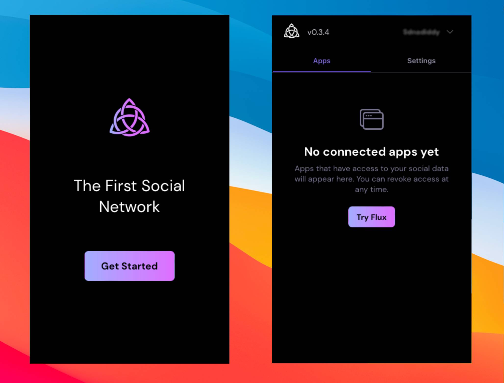

import { Callout } from "nextra/components";

# Run an executor

The executor is the process that holds an agent's keys, perspectives and languages and serves them to apps (RPC on port 12000) and agents (MCP on port 3001). There are three ways to run one.

## Local: the Launcher

The Launcher is the desktop app (Tauri) that bundles the executor with a settings UI and the dialog that approves capability requests from apps. Download it from the [GitHub releases](https://github.com/coasys/ad4m/releases), start it, and generate or unlock your agent. It writes its settings to `~/.ad4m/launcher-state.json` and generates an admin credential for itself on each start, so you never type one.



Use it when the executor is for one person on their own machine. Settings include the MCP server toggle and port, TLS and multi-user mode.

## Headless: `ad4m-executor run`

The `cli/` crate builds two binaries: `ad4m-executor` (the runtime) and `ad4m` (a client for it). Build them from the repository:

```bash
git clone --branch dev https://github.com/coasys/ad4m.git
cd ad4m/cli && cargo build --release
```

`ad4m-executor` has five subcommands: `init`, `run`, `config print`, `log` and `dev`.

```bash
ad4m-executor init                      # create ~/.ad4m (or --data-path) and the bootstrap seed
export AD4M_ADMIN_CREDENTIAL_FILE=/etc/ad4m/secrets/admin-credential   # mode 0600
ad4m-executor run --port 12000 --app-data-path ~/.ad4m
```

`run` refuses to start without an admin credential. Pass it as a file (`AD4M_ADMIN_CREDENTIAL_FILE`) or a variable (`AD4M_ADMIN_CREDENTIAL`); `--admin-credential <value>` works but is visible in `ps`. For tests only, `--insecure-no-admin-credential` starts without one; an empty token then has full admin access on the loopback port.

Every flag of `run` also reads an `AD4M_<FLAG>` variable (`--mcp-port` reads `AD4M_MCP_PORT`), and `--config <file>` (or `AD4M_CONFIG`) reads a JSON file with the Launcher's key names. A flag beats its variable, and a variable beats the file. `ad4m-executor config print` shows the merged result with secrets redacted. The flags that matter most:

| Flag | Default | What it does |
|---|---|---|
| `--port` | `12000` | RPC port (HTTP and WebSocket) |
| `--app-data-path` | `~/.ad4m` | Data directory |
| `--localhost` | `true` | Bind the RPC port to `127.0.0.1` |
| `--run-dapp-server` | `true` | Serve the bundled web dapp on port 8080 |
| `--enable-mcp` / `--mcp-port` | `false` / `3001` | The MCP server |
| `--auto-permit-cap-requests` | `true` without `--config`, `false` with it | Grant capability requests without a user confirming them |
| `--run-holochain` | `true` | Start the bundled Holochain conductor |
| `--enable-multi-user` | `false` | Multi-user host mode |
| `--tls-cert-file` / `--tls-key-file` / `--tls-port` | off / `port + 1` | HTTPS and WSS listener on `0.0.0.0` |

The complete list, with the config-file keys and the environment variables, is on [Executor config](../reference/executor-config.mdx). A systemd unit, Docker and unlocking at startup are on [Headless executor](../how-to/headless-executor.mdx).

Unlock the agent after every start: `ad4m agent unlock` (the `ad4m` client prompts for the passphrase), or set `AD4M_UNLOCK_PASSPHRASE_FILE` so `run` does it itself.

## Hosted: a multi-user node

One executor process can serve many users, each with their own DID and isolated perspectives, behind TLS and an email-and-password sign-up. Apps connect to it with `@coasys/ad4m-connect` as they do to a local executor; the dialog changes, the model API does not. The concept is on [Hosted deployment](../concepts/hosted-deployment.mdx); DNS, certificates, firewall and the hosting index are on [Multi-user host](../how-to/multi-user-host.mdx).

## Where data lives

Everything is under the data directory, `~/.ad4m` by default (`--app-data-path` changes it):

| Path | Holds |
|---|---|
| `~/.ad4m/ad4m_db.sqlite` | The database: perspective records, agent and runtime state |
| `~/.ad4m/perspectives/<uuid>/sparql_store/` | The links of one perspective (an RDF store on RocksDB) |
| `~/.ad4m/ad4m/h/` | Holochain conductor data |
| `~/.ad4m/ad4m.log` | The executor log, written by the Launcher (`ad4m log` prints it); `ad4m-executor run` logs to stdout |
| `~/.ad4m/ad4m/languages/` | Installed languages |
| `~/.ad4m/mainnet_seed.seed` | The bootstrap seed `init` writes (the system languages to install) |
| `~/.ad4m/executor-port` | The port the Launcher's executor listens on, written by the Launcher; the `ad4m` client reads it |
| `~/.ad4m/launcher-state.json` | Launcher settings (not a `--config` file) |

The `ad4m` client keeps its own capability token in `~/.ad4m-cli/cap_token`.

<Callout type="warning">
Back up the data directory as a whole: the keys and the database belong together. There is no recovery for a lost keystore.
</Callout>

## Ports

| Port | Default | Set by |
|---|---|---|
| RPC | `12000` | `--port` |
| TLS RPC | `port + 1` | `--tls-port` |
| Dapp server | `8080` | `--run-dapp-server` on or off |
| MCP | `3001` (TLS: `+ 1`) | `--mcp-port` |
| Holochain admin / app | first free from `2000` / `1337` | `--hc-admin-port`, `--hc-app-port` |

## Next

- [Headless executor](../how-to/headless-executor.mdx), [Multi-user host](../how-to/multi-user-host.mdx)
- [CLI reference](../reference/cli.mdx), [Executor config](../reference/executor-config.mdx)
- [Agent, executor and capabilities](../concepts/agent-executor-capabilities.mdx)
