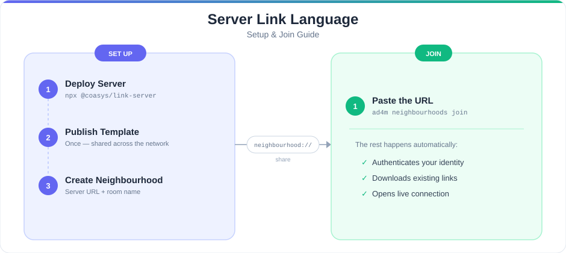

# @coasys/link-server

A self-hostable link language server for [AD4M](https://github.com/coasys/ad4m). Communities run this on their own hardware; AD4M agents authenticate with their DID and sync link data through it. Think Matrix homeserver, but purpose-built for AD4M link sync instead of chat.

**Companion package:** [`server-link-language`](../bootstrap-languages/server-link-language/README.md) — the AD4M link language that talks to this server.



## Quickstart

```bash
npx @coasys/link-server --port 3456 --data ./my-data
```

Or with Docker:

```bash
cd link-server
docker compose up -d
```

The server generates its own JWT signing secret on first run (`<data-dir>/data.sqlite`). A room comes to be when its creator's language sends the room's first membership links (the genesis): there is no separate provisioning step. To admit people, the server needs an identity store (`STORE_URL`, `STORE_HEAD_KEYS`): it asks the store which person each key speaks for.

The server judges membership links with the identity core's WASM binding, which is generated, not committed. Build it once from the repo before building, testing or making the image (it needs Rust with the `wasm32-unknown-unknown` target and the `wasm-bindgen` CLI that `Cargo.lock` locks; the script prints the install command):

```bash
bash ad4m-identity-core/build-node.sh    # writes link-server/identity-core/ (gitignored)
```

## Run with Docker

Build and start the server:

```bash
cd link-server
docker compose up -d
```

The server listens on port 3456 and stores data in a named Docker volume (`link-server-data`). Override settings with environment variables:

```bash
PORT=4000 STORE_URL=https://store.example.org STORE_HEAD_KEYS=z6Mk... docker compose up -d
```

| Variable | Default | What it does |
|---|---|---|
| `PORT` | `3456` | Listen port (host and container) |
| `NAME` | `link-server` | The server's name in `/.well-known/coasys-link-server` |
| `STORE_URL` | none | The identity store's base URL |
| `STORE_HEAD_KEYS` | none | Comma-separated multikeys of the store keys whose signed heads are trusted |
| `AUTO_ADMIT` | `false` | Admit every authenticating key (tests and development only; refused unless `ALLOW_AUTO_ADMIT_DEV=true`, and always with `NODE_ENV=production`) |
| `ALLOW_AUTO_ADMIT_DEV` | `false` | Marks a development server: the only kind that starts with `AUTO_ADMIT` |

The image copies `link-server/identity-core/`, so run `ad4m-identity-core/build-node.sh` before `docker compose build`.

The Dockerfile includes a `HEALTHCHECK` that polls `GET /health` every 30 seconds. Use `docker inspect` or `docker compose ps` to confirm the container reports healthy.

To stop:

```bash
docker compose down        # stop the container (data persists in the volume)
docker compose down -v     # stop and delete the data volume
```

## Usage

### Configuration

Control the server through environment variables or CLI flags:

| Environment variable | CLI flag | Default | What it does |
|---|---|---|---|
| `PORT` | `--port` | `3456` | Listen port |
| `DATA_DIR` | `--data` | `./data` | Storage directory (SQLite database) |
| `HOST` | `--host` | `0.0.0.0` | Listen address |
| `NAME` | `--name` | `link-server` | The server's name in `/.well-known/coasys-link-server` |
| `STORE_URL` | `--store-url` | none | The identity store's base URL (`/v1/keys/{multikey}`, `/v1/heads/{scid}`, `/v1/logs/{scid}`). Without it no person can be admitted |
| `STORE_HEAD_KEYS` (comma-separated) | `--store-head-keys` | none | The store keys whose signed heads are trusted |
| `AUTO_ADMIT` | `--auto-admit` | `false` | Admit every key that authenticates, member or not. For tests and development: the server refuses to start with it unless `ALLOW_AUTO_ADMIT_DEV=true`, and always with `NODE_ENV=production` (the Docker image sets it) |
| `BODY_LIMIT` | `--body-limit` | `10485760` | Maximum HTTP request body size in bytes (10 MiB) |
| `OPERATOR_PORT` | `--operator-port` | off | Also serve the [operator page](#operator-page-operator-listener) and its API on this port (1-65535; the proxy needs a fixed port) |
| `OPERATOR_HOST` | `--operator-host` | `127.0.0.1` | Address of the operator listener; must be loopback |
| `OPERATOR_TOKEN_FILE` | `--operator-token-file` | none | File (mode 600) holding the operator API token; required with `--operator-port` |
| `OPERATOR_ORIGINS` (comma-separated) | `--operator-origin` (repeatable) | none | Origin the operator page is served from; POSTs from anywhere else are refused. Required with `--operator-port` |
| `OPERATOR_LABEL` | `--operator-label` | none | Instance name shown on the operator page (`staging`, `prod`) |

### Rooms and membership (protocol 2)

Who belongs to a room is the room's own business, written as signed **membership links** (predicates under `coasys://membership/`: `rules`, `join`, `admin`, `member`, `invite`, `removed`, `bot`). The server keeps them, judges each one with the identity core (the same judgement every member's language runs), and admits a key only when the person it speaks for is a current member. The server holds no allowlist of its own, and neither the server nor its operator can add a member.

- **A room is created by its creator.** The room id is `base58(sha256(creator ‖ 0x00 ‖ salt))`, where `creator` is the creator's person DID (`did:scid:coasys:1:…`). The first `POST /rooms/:roomId/membership` carrying `genesis: {creator, salt}` and the creator's `rules` link creates it; nothing else does. Auth to an unknown room answers `404` and creates nothing.
- **Keys speak for persons.** A device key (`did:key`) signs in; the server asks the identity store, through the person's key log, which person the key belongs to now, and whether it is a bot key. A key whose log revoked it, or that expired, is refused (`403`); a key no log lists signs in but is never admitted; while the store cannot answer, auth answers `503` and admits no one.
- **Joining.** A signed-in key that is not admitted yet may send one thing: its own person's self-join (`<person> member <space or invite>`), which counts in an open room or with a valid invite. An admin adds members in a room whose rules let admins add. A bot key never joins by itself; its owner's `bot` link brings it in.
- **Removal.** A `removed` link by an admin ends the person's access at once: the sessions of each of their keys are deleted, their sockets close with `4005`, and the room hears `rotate-needed` naming the keys the next room key must leave out.
- **Posting membership links.** `POST /rooms/:roomId/membership` takes at most 100 links (genesis included); more answers `400` before anything else is looked at. A link whose signature does not hold is refused without asking the store. A self-join the server does not have yet must be dated within 5 minutes of the server's clock, whoever posts it; otherwise it is refused as `stale` (`403`), neither stored nor relayed, so no one can date a join back into a period the room was open or an invite was valid. Admin links (invites, adds, removals, rules) keep their own dates: an admin may sign them offline. A link the server already has answers `repeated` with `stored: true` and does not count again. The answer is `200` when any link was stored, otherwise `403` with the first link's reason.
- **Revocation.** Every 10 minutes the server asks the store again about every key not revoked in some room it signed in to (with or without a socket or a session) and every key with an open socket. A key its log has revoked loses its sessions and sockets (`4005`), and each room it was in hears `rotate-needed` (`revoked`). A key revoked in a room is refused there (`401`), is left out of the admitted keys a rotation must seal to, and gets no grant. A store outage, or any error about one key, ends no one's access; the sweep goes on with the next key.
- **Rooms from before protocol 2** are kept but marked legacy and answer `410` to protocol 2 clients.

### Admission mode

The server runs in one of two modes. It logs the mode at startup (`admission mode: …`), and the operator page shows it at the top.

| Mode | Set by | A key whose person is not a member |
|---|---|---|
| **membership** (default) | nothing; `AUTO_ADMIT` unset or false | gets a token with `admitted: false`: it may send its self-join and nothing else, until its person counts as a member. |
| **auto** | `AUTO_ADMIT=true` or `--auto-admit` | is admitted. For tests and development only: the server refuses to start with it unless `ALLOW_AUTO_ADMIT_DEV=true`, and always when `NODE_ENV=production`. Without a store, every key is treated as a device key of no person. |

### Operator page (operator listener)

Whoever runs the server can turn on a second listener with a small web page and API to see the rooms, their members and keys, follow the log, and suspend or resume a room. It is read-only for membership: the operator cannot add or remove anyone (`/api/rooms/:id/acl` answers `404`).

```bash
umask 077; openssl rand -hex 32 > /srv/link-server/operator-token     # mode 600, never on argv
link-server --host 127.0.0.1 --port 13102 --data /srv/link-server/data \
  --operator-port 13104 --operator-token-file /srv/link-server/operator-token \
  --operator-origin https://admin.example.org --operator-label prod
```

One listener serves one instance. Run staging and prod as separate servers with separate operator ports, mounted at separate paths, so a page never switches between instances.

- The listener binds to loopback only and refuses any other address. It is a separate Fastify app, so the public port never serves it.
- Every `/api/*` call needs `Authorization: Bearer <operator token>`, compared in constant time. The token is read from a file that only its owner may read. It never goes on argv or into a URL, and the request log has no headers in it.
- Every `/api/*` call also needs `X-Forwarded-User`, the signed-in login (GitHub login syntax). The proxy sets it from the sign-in subrequest. The header is trusted only because the listener is loopback-only and reached through that proxy, and the proxy must overwrite any value a client sends.
- CSRF: the sign-in is a cookie, so every `POST` needs an `Origin` from `--operator-origin`. When a browser sends no `Origin`, a `Referer` on that origin is accepted instead. A request with neither is refused, as is one marked `Sec-Fetch-Site: cross-site`. `POST` also needs `Content-Type: application/json`.
- **Suspend and resume.** `POST /api/rooms/:id/suspend` stops a room: every request to it answers `423`, its sessions are deleted and its sockets close with `4006`. Its links, membership and keys stay. `POST /api/rooms/:id/resume` undoes it. Each change is logged as `operator suspend` / `operator resume` with the login and the instance; repeating one changes nothing and logs nothing.
- **Live logs:** the page shows the server's log as it is written (both listeners), with a level filter. `GET /api/logs` streams it as Server-Sent Events: the last 1000 lines first, then each new one. A reconnect gets the last 1000 lines again and the page starts its list over. If the sign-in has expired, the panel stops updating: reload the page. The lines are kept in memory only, at most 8 streams are open at once, and a stream sends `X-Accel-Buffering: no` and a comment line every 15 s, so nginx neither buffers it nor closes it as idle. The lines are what the server already writes to stdout: no headers, so no tokens.

**Trust model.** The operator can stop a room, read its metadata (who is a member, which keys signed in, when) and its ciphertext, but cannot make anyone a member: membership is the room's signed links, judged against each person's key log, and a room key is sealed only to the keys those links admit.

**Wiring it behind a sign-in.** Put a reverse proxy in front that signs the human in and injects the token, so the browser never holds it. With nginx and [oauth2-proxy](https://oauth2-proxy.github.io/oauth2-proxy/) (GitHub provider, `github_users` allowlist = the operators), on a host of its own:

```nginx
server {
    listen 443 ssl;
    server_name link-admin.example.org;
    # ssl_certificate ... ;
    add_header X-Robots-Tag "noindex, nofollow" always;
    client_max_body_size 16k;

    location /oauth2/ {
        proxy_pass http://127.0.0.1:4181;       # oauth2-proxy for this host
        proxy_set_header Host $host;
        proxy_set_header X-Real-IP $remote_addr;
        proxy_set_header X-Forwarded-Proto $scheme;
        proxy_set_header X-Auth-Request-Redirect "";
    }
    location = /oauth2/auth {
        internal;
        proxy_pass http://127.0.0.1:4181;
        proxy_pass_request_body off;
        proxy_set_header Content-Length "";
        proxy_set_header Host $host;
        proxy_set_header X-Real-IP $remote_addr;
        proxy_set_header X-Forwarded-Proto $scheme;
        proxy_set_header X-Forwarded-Uri $request_uri;
    }
    location @sign_in { return 302 /oauth2/start?rd=$request_uri; }

    location / {
        auth_request /oauth2/auth;
        error_page 401 = @sign_in;
        auth_request_set $op_user $upstream_http_x_auth_request_user;
        auth_request_set $op_cookie $upstream_http_set_cookie;
        add_header Set-Cookie $op_cookie;
        add_header X-Robots-Tag "noindex, nofollow" always;

        proxy_pass http://127.0.0.1:13104;
        # One line, root-only file (mode 600):  proxy_set_header Authorization "Bearer <operator token>";
        # proxy_set_header replaces whatever Authorization the client sent.
        include /etc/nginx/snippets/link-admin-token.conf;
        proxy_set_header Host $host;
        proxy_set_header X-Forwarded-User $op_user;   # set here, never passed through
        proxy_set_header Cookie "";                   # the sign-in cookie stays at the proxy
        proxy_set_header X-Real-IP $remote_addr;
    }
}
```

```toml
# oauth2-proxy.cfg (client secret and cookie secret in files, not here)
provider = "github"
client_id = "<GitHub OAuth app for link-admin.example.org>"
client_secret_file = "/path/to/client-secret"        # mode 600
cookie_secret_file = "/path/to/cookie-secret"        # mode 600
redirect_url = "https://link-admin.example.org/oauth2/callback"
github_users = ["alice", "bob"]
email_domains = ["*"]
http_address = "127.0.0.1:4181"
reverse_proxy = true
upstreams = ["static://202"]
set_xauthrequest = true
cookie_name = "_link_admin_oauth2"
cookie_secure = true
cookie_samesite = "lax"
```

The page uses relative URLs, so it also works mounted under a path on a host that already has an oauth2-proxy sign-in, one path per instance: `location /link-admin/staging/ { ... proxy_pass http://127.0.0.1:13105/; }`. Start that instance with `--operator-origin https://<that host>`.

### Connecting AD4M agents to this server

The server handles storage and sync — it does not speak AD4M on its own. The companion [**server-link-language**](../bootstrap-languages/server-link-language/README.md) bridges the gap: AD4M agents load that language, which then connects to this server, authenticates, and syncs links automatically. See that package for instructions on publishing the language and creating neighbourhoods.

### End-to-end encryption

Every room's links are end-to-end encrypted from creation: the server refuses plaintext links in every room, before any key exists. (Membership links are the exception: they are plain and signed, so the server can judge them, and they go to `/membership`, never `/commit`.) The creator's language rotates in key version 1 before its first commit, and members wait for a key before they commit anything. Presence and telepresence signals are relayed as sent, not encrypted.

E2E encryption uses **true client-side key generation**: a member's language generates each room key locally, seals it to every admitted key (ephemeral X25519 ECDH + HKDF-SHA256 + AES-256-GCM, the AD4M executor's sealed box), and uploads only the sealed boxes. The server never sees the plaintext key. Each key's X25519 key comes from its auth: the key signs it (`x25519Signature`), and `GET /members` lists it with that signature, so a member checks the signature before sealing to it.

```bash
# Mint the first room key, or rotate it (any member).
# The client generates the key, seals it to each key GET /members lists,
# and POSTs only sealed boxes:
curl -X POST https://your-server:3456/rooms/YOUR_ROOM/keys/rotate \
  -H "Authorization: Bearer $ADMIN_TOKEN" \
  -H "Content-Type: application/json" \
  -d '{"keys": [{"did": "did:key:z6Mk...", "encryptedKey": {"ephemeralPublicKey": "...", "nonce": "...", "ciphertext": "..."}}], "commitment": "<sha256 hex>"}'
```

A rotation must seal the new version to exactly the keys admitted now, including keys that are not connected; otherwise it is refused with `409 {missing, extra}`. Each key reads its box the next time it connects or refreshes its key ring. A member rotates when the room asks for it (`rotate-needed`): after a join, a removal or a revocation. Every room rejects plaintext commits, so a client without keys cannot write until it receives them.

A member added after a rotation gets the versions it lacks from any member holding them: every member's language reads `GET /keys/missing` and seals the versions it holds to the members lacking them (`POST /keys/grant`, see `src/room-keys.ts` in server-link-language). The server accepts a grant only of versions the granter holds, and keeps the first box stored per member and version.

The server cannot see inside a box, so a member could grant a key that opens but is not the room's. Each rotation therefore carries a `commitment` (SHA-256 of `ad4m:room-key-commitment:v1` and the key), returned with every box from `GET /keys`. A member keeps an opened key only if it matches; otherwise it drops its own box (`DELETE /keys/:version`), the version shows as missing again, and a member holding it grants it.

## How it works

- **Rooms** are independent link-sync spaces. A room's id commits to its creator and a salt (`base58(sha256(creator ‖ 0x00 ‖ salt))`), and the creator's genesis creates it.
- **Auth** is one signed request: a device key signs `coasys-link-server:auth:2:<roomId>:<timestamp>` (within 5 minutes of the server's clock, each body good once) and its X25519 key, and receives a JWT scoped to `(did, roomId)` with `admitted` saying whether its person is a member.
- **Membership** gates every room endpoint: the room's signed membership links, replayed by the identity core, say who is a member; the identity store's key logs say which person a key speaks for.
- **Links** are stored as an append-only diff log (`PerspectiveDiff` = additions/removals of signed `LinkExpression`s) plus a derived active-set table. The diff log is never pruned: it is what `/sync?since=N` answers from, and a member whose cursor is N gets every diff after N. Rooms on a server that ran an earlier version may already have lost early diffs to its pruning; their active set is complete, so `/render` still gives a member behind that gap the room's whole state. Compacting the log would need an answer that tells a client its cursor is too old, so that client re-renders; the server has none. Each commit adds one row, so a deployment's disk grows with its rooms' history: size the volume for it, since a write fails once SQLite cannot grow its file. The **revision** is a content hash of the active set's link hashes — order-independent, so two servers with the same active links converge to the same revision regardless of how they got there.
- **WebSocket** push delivers committed diffs and telepresence events in real time.
- **E2E encryption** is on from creation in every room: the entire `LinkExpression` (author, timestamp, proof, and data) becomes an opaque ciphertext blob. The server sees only `{ciphertext, nonce}` (base64) plus a client-computed `link_hash` for OR-Set dedup, stores and sends them as the client wrote them, and rejects plaintext commits.

See [`AGENTS.md`](./AGENTS.md) for architecture, file layout, and implementation decisions made where the spec was ambiguous.

## API

Protocol 2. All room endpoints except `/rooms/:roomId/auth` and a genesis `POST /membership` require `Authorization: Bearer <jwt>` of a key admitted to the room (`/membership` also takes a token not yet admitted, for its self-join). A suspended room answers `423`, a room from before protocol 2 `410`.

```text
GET  /.well-known/coasys-link-server -> { protocol: 2, name, membership: true }
POST /rooms/:roomId/auth      { did, signature, timestamp, x25519PublicKey, x25519Signature }
                               -> { token, expiresAt, admitted }
                               (404 unknown room, nothing created; 401 bad signature, clock or replay;
                                403 key revoked or expired; 503 identity store unavailable)
POST /rooms/:roomId/membership { genesis?: {creator, salt}, links: WireMembershipLink[] }
                               -> { results: [{hash, counted, reason?}] }
                               (403 {reason, results} when no link counts; a link that does not count is not relayed)
GET  /rooms/:roomId/membership ?since=<seq>[&limit=<n>] -> { links: WireMembershipLink[], seq }
GET  /rooms/:roomId/members   -> { members: [{person, role, botOf, since, until: null}],
                                   keys: [{did, person, byBot, x25519PublicKey, x25519Signature}] }   (the admitted keys)
POST /rooms/:roomId/commit    { additions: LinkExpression[], removals: LinkExpression[] } -> { sequence, revision }
                               (400 unless every link has data exactly { ciphertext, nonce } (strings; base64 by client convention, not checked) and a link_hash, and key_version, when sent, is a positive integer;
                                400 for a membership predicate)
GET  /rooms/:roomId/sync      ?since=<sequence>[&limit=<n>] -> { diffs: (PerspectiveDiff & {sequence})[], revision, sequence, next }
GET  /rooms/:roomId/render    ?[limit=<n>][&next=<cursor>] -> { links: LinkExpression[], revision, sequence, upto, next }
GET  /rooms/:roomId/revision  -> { revision, sequence }
GET  /rooms/:roomId/peers     -> { peers: string[] }               (currently online agents)
GET  /rooms/:roomId/keys       -> { keys: [{encryptedKey, version, commitment}] }   (empty before the caller holds a key)
DELETE /rooms/:roomId/keys/:version -> { deleted }      (the caller's own box only)
GET  /rooms/:roomId/keys/missing  -> { membersNeedingHistoricalKeys: [{did, missingVersions}] }
POST /rooms/:roomId/keys/grant    { targetDid, keys: [{version, encryptedKey}] } -> { granted }
                                   (any member; 403 for a version the caller does not hold)
POST /rooms/:roomId/keys/rotate { keys, commitment } (any member) -> { version, recipients, membersNeedingHistoricalKeys }
                                 (409 {missing, extra} unless the keys are exactly the admitted keys)
GET  /rooms/:roomId/ws              (WebSocket upgrade — first message must be {type:"auth",token:"<jwt>"})
```

Operator listener (only with `--operator-port`; all `/api/*` need the operator token):

```
GET  /                          operator page (+ /admin.js, /admin.css; CSP default-src 'self', no inline styles or scripts)
GET  /api/whoami                -> { operator, instance, admission: "membership" | "auto" }   (X-Forwarded-User, --operator-label)
GET  /api/rooms                 -> { rooms: [{ id, creator, createdAt, legacy, suspended, memberCount }] }
GET  /api/rooms/:roomId         -> { id, creator, createdAt, legacy, suspended, memberCount,
                                     members: [{ person, role, botOf, since, online }],
                                     keys: [{ did, person, byBot, revoked, admitted, online, updatedAt }] }
POST /api/rooms/:roomId/suspend {} -> same as GET /api/rooms/:roomId   (404 for an unknown room)
POST /api/rooms/:roomId/resume  {} -> same as GET /api/rooms/:roomId
GET  /api/logs                  -> text/event-stream; the last 1000 lines, then each new one; each event:
                                     data = { level, time, msg, ...pino fields } (a non-JSON line: { msg })
                                     (404 when logging is off, 429 past 8 open streams)
```

JSON answers over 1 kB are compressed (br or gzip) when the request sends `Accept-Encoding`, and sent plain when it does not. `/render` and `/sync` always answer one page: `limit` is 1 to 5000 (anything else is a 400), and a request without it gets a page of 500. See the next section.

### Paged snapshot, then tail

A large room's full link set does not fit one request: 30 000 encrypted links are 28 MB of JSON, more than a client's 10 s fetch deadline receives on a slow link, and the server serialises it on its one event loop while every other member waits. So a client loads a room in two bounded phases. This is the pattern for any HTTP link language that syncs through this server:

1. **Snapshot, pinned at a sequence.** `GET /render?limit=N` returns the first page and `upto`, the room's latest sequence at that moment. Each later `GET /render?limit=N&next=<cursor>` returns the next page of the same snapshot: links added at or before `upto`, ordered by `(sequence, link_hash)`, after the cursor. `next` is `null` on the last page. The cursor is opaque and carries `upto`, so a client stores it and resumes after a restart at the page it reached.
2. **Tail the log from `upto`.** `GET /sync?since=<upto>&limit=M` returns at most `M` diffs after `since`, each with its `sequence`; `next` is the `since` of the following page, `null` on the last. The revision of the last page belongs to the room's latest sequence.

The snapshot is for a client's first load only. A client that has applied anything holds a cursor, and on every later start it tails `/sync` from that cursor instead: the diff log after it carries every add and remove. That relies on the server keeping the whole diff log.

Why this is correct under concurrent writes: a link added after `upto` gets a later sequence, so it never appears in a snapshot page; a link removed while the pages are read drops out of the pages not yet read. Every add and remove after `upto` is in the diff log, so the tail brings each change the pages missed, and applying a removal of a link the client never got is a no-op.

What a client does:

- On its first load (an empty store, cursor 0), apply and emit each page as its own diff as it arrives; store the render cursor after each.
- Leave WebSocket pushes that arrive before the last page to the render: one before the first page is inside the snapshot, one after it is in the tail.
- Then tail `/sync?since=upto` page by page, moving its cursor to each entry's `sequence` as it applies it. Nothing needs removing: the store held nothing before the snapshot but the client's own commits, which are in the snapshot or the tail.

`npm run bench` measures a 30 000-link room (`LINKS=` to change it): bytes and time for every page of `/render` and `/sync`, and for the largest and slowest one, with and without compression. It then posts 1 000 membership links (`MEMBERS=`, `MEMBERSHIP_BATCH=` per request) and measures judging and storing them, reading them back, a cold replay and an auth in that room.

### WebSocket messages

Server -> client: `diff`, `membership {links, seq}` (the membership links that counted), `rotate-needed {reason: "joined"|"removed"|"revoked", removedKeys}`, `telepresence-signal`, `telepresence-broadcast`, `online-agents`, `peer-joined`, `peer-left`, `status-changed`, `keys-granted {versions}` (to the grantee's sockets after a stored grant), `auth-error`.
Close codes: `4005` the key was removed from the room or revoked by its log; `4006` the room was suspended.
Client -> server: `auth { token }` (first message only), `telepresence-signal { toDid, payload }`, `telepresence-broadcast { payload }`, `set-online-status { status }`.

### Rate limits

100 req/min per IP on `/auth` and on `POST /membership`, 300 req/min per JWT on room endpoints, 60 req/min per JWT on `/commit` specifically (stacked on top of the general room limit). Sliding window, in-memory. `429` responses carry `Retry-After` in seconds.

## Development

```bash
npm install       # NODE_ENV must not be "production" or devDependencies won't install
bash ../ad4m-identity-core/build-node.sh   # once: the identity core binding (link-server/identity-core/)
npm test          # node's built-in test runner, tests/*.test.ts
npm run build     # tsc -> dist/
npm run dev       # tsx src/index.ts, no build step
```

Tests boot a real server per test (random port, temp SQLite file) and drive it over real HTTP/WebSocket — there are no mocks of the server itself.

## Known limitations

### E2E encryption — trust model and remaining gaps

Key generation happens exclusively client-side — a member generates each
room key locally, seals it to the admitted keys, and uploads only sealed boxes.
The server never touches plaintext key material, and it cannot swap a member's
X25519 key: each one is signed by the device key it belongs to.

**Remaining gaps:**

- **The server knows who is in a room.** Membership links are plain so the
  server can judge them: the server and its operator see the room's members
  and which keys signed in, though they cannot add anyone.
- **A member can spoil a grant.** The server cannot check the key inside a
  box. A member that grants a box holding a wrong key for a version stores the
  first box for that member and version. The recipient's language finds that
  the key does not match the version's `commitment`, leaves the version out of
  its key ring and drops its own box (`DELETE /rooms/:roomId/keys/:version`).
  The version then shows as missing again, and a member holding it grants it
  again. Until then the recipient cannot open the links of that version. Only
  a member of the room can do this, and only for versions it holds. A member
  that grants a wrong box again after each drop can win that race every time;
  removing it from the room stops it. With `AUTO_ADMIT` the server admits it
  again at its next sign-in.

### E2E encryption — other future requirements

- **Key revocation is not retroactive:** a device key its person revokes
  loses its access within 10 minutes and the next room key leaves it out, but
  it keeps the room keys it already opened, and so the history they encrypt.
- **Perfect forward secrecy:** room keys are long-lived. Compromising a room
  key exposes all past ciphertext sealed under it. A ratchet or epoch-based
  key rotation would bound the exposure window.
